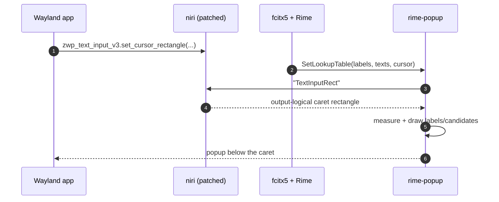

# rime-popup

A Wayland daemon that draws **fcitx5 / Rime candidate windows under the caret**
on [niri](https://github.com/yekeno/niri), with fcitx5's position numbers kept
(`1. 你  2. 泥  …`).

It runs as an ordinary user process. It owns fcitx5's kimpanel bus name, asks
the compositor where the focused text input's caret is, and paints one
`zwlr_layer_shell_v1` surface there with `tiny-skia` + `wl_shm`. No privileged
access and no fcitx5 fork are required.

- **Companion compositor fork:** https://github.com/yekeno/niri
- **Design and data flow:** [docs/architecture.md](docs/architecture.md)
- **Tested on:** Ubuntu 22.04.5 LTS, Wayland, niri 26.04 (patched), fcitx5 5.0.14 + fcitx5-rime 5.0.11

## Features

- Candidate window follows the text caret on **Wayland clients**
  (`zwp_text_input_v3`), not just X11/XIM clients.
- **Numbers preserved.** Labels supplied by fcitx5 (`1.`, `2.`, `a.`, …) are
  rendered before each candidate; missing labels are numbered automatically.
- Rime / fcitx5 candidate highlighting, paging indicator, CJK shaping via
  swash, and a configurable colour scheme.
- Input-transparent overlay surface: typing goes to the focused app, never to
  the popup.
- Reloads configuration on `SIGHUP`; `SIGUSR1` dumps caret/focus state.
- Degrades safely: if the compositor cannot report a caret, the daemon leaves
  fcitx5's own candidate window untouched instead of stealing it.

## How it works

```mermaid
flowchart LR
    A[Wayland app] -->|set_cursor_rectangle| N[niri + TextInputRect patch]
    F[fcitx5 + Rime] -->|kimpanel SetLookupTable| R[rime-popup]
    R -->|IPC "TextInputRect"| N
    N -->|caret x/y/w/h| R
    R -->|wl_shm buffer| L[layer-shell overlay]
    L --> S[numbered candidates under the caret]
```



The full module map and state machine are in
[docs/architecture.md](docs/architecture.md).

## Why the niri patch is required

Wayland clients send their caret rectangle to the **compositor**, never to the
input method. For Wayland clients fcitx5's kimpanel `SetSpotRect` is therefore
empty, and fcitx5's classic UI relies on a compositor-placed input-method
popup surface.

[yekeno/niri](https://github.com/yekeno/niri) adds a `TextInputRect` IPC
request:

```text
→ "TextInputRect"
← {"Ok":{"TextInputRect":{"x":812,"y":244,"width":2,"height":18}}}
```

niri answers in output-logical coordinates by adding the focused window's
position to the client's surface-local rectangle. It also clears the cached
rectangle when keyboard focus changes, so a stale caret cannot leak between
windows.

That request depends on a small [smithay
fork](https://github.com/yekeno/smithay/tree/niri-text-input-rect) exposing the
cached `zwp_text_input_v3` cursor rectangle. The niri fork's `[patch]` section
points at it automatically.

If niri does not answer, rime-popup deliberately does **not** own
`org.kde.impanel`; fcitx5 stays on `classicui` and keeps its own candidate
window. See
[niri's patch documentation](https://github.com/yekeno/niri/blob/main/docs/text-input-rect.md).

## Tested environment

This is the machine the feature was developed and verified on:

| Component | Version / value |
| --- | --- |
| OS | Ubuntu 22.04.5 LTS (jammy), x86_64 |
| Kernel | 6.8.0-138-generic |
| libc | glibc 2.35 |
| Session | Wayland (`XDG_SESSION_TYPE=wayland`, `XDG_CURRENT_DESKTOP=niri`) |
| Compositor | niri 26.04 (`v26.04-192-g4263c9a1` + TextInputRect patch) |
| smithay | 0.7.0 at upstream `9786228` + cursor-rectangle accessor |
| Input method | fcitx5 5.0.14, fcitx5-rime 5.0.11, librime 1.7.3 |
| Rust | rustc / cargo 1.93.1 (rustup) |
| libinput | 1.25.0 from source (Ubuntu 22.04 stock 1.20 is too old for niri) |
| Wayland | 1.24.0 (`savoury1/display` PPA) |
| libdisplay-info | 0.2.0 (`savoury1/display` PPA) |
| CJK font | `/usr/share/fonts/opentype/noto/NotoSansCJK-Regular.ttc` |

Ubuntu 22.04 needs two non-stock pieces before niri builds: `libdisplay-info`
and libinput ≥ 1.21. The tested machine builds libinput 1.25.0 into a private
prefix (`/srv/tools/wm/build/libinput-prefix`) and points pkg-config and the
linker at it (`RUSTFLAGS` carries both `-L native=…` and an rpath). The exact
commands are in
[niri's build documentation](https://github.com/yekeno/niri/blob/main/docs/text-input-rect.md#building-this-fork-on-ubuntu-2204).

Ubuntu 22.04 ships older `libwayland` and no `libdisplay-info-dev`; the niri
build instructions below use the `savoury1/display` PPA for those two
packages. rime-popup itself only needs `libwayland-dev`.

## Installation

### 1. Install the patched niri

Follow
[niri's build instructions](https://github.com/yekeno/niri/blob/main/docs/text-input-rect.md).
The short version:

```bash
sudo apt update
sudo apt install -y build-essential pkg-config clang \
    libudev-dev libgbm-dev libxkbcommon-dev libegl1-mesa-dev \
    libwayland-dev libinput-dev libsystemd-dev libdbus-1-dev \
    libseat-dev libpipewire-0.3-dev libpango1.0-dev

# Ubuntu 22.04: newer Wayland + libdisplay-info
sudo add-apt-repository ppa:savoury1/display
sudo apt update
sudo apt install -y libdisplay-info-dev libwayland-dev

# Ubuntu 22.04 ships libinput 1.20, but niri needs >= 1.21 (dwtp symbol).
# Build 1.25.0 into a private prefix and export it before cargo build; see
# https://github.com/yekeno/niri/blob/main/docs/text-input-rect.md

git clone https://github.com/yekeno/niri.git
cd niri
cargo build --release
sudo install -m755 target/release/niri /usr/local/bin/niri
```

Log out and back in so the running compositor is the patched binary. Verify:

```bash
niri --version
printf '"TextInputRect"\n' | socat - "UNIX-CONNECT:$NIRI_SOCKET"
```

The second command must print an `Ok` reply (with a rectangle or `null`).

### 2. Install fcitx5 + Rime

```bash
sudo apt install -y fcitx5 fcitx5-rime fcitx5-modules fonts-noto-cjk
```

Make sure fcitx5 starts with your Wayland session and Rime is selected as the
input method. kimpanel support (`libkimpanel.so`) ships in `fcitx5-modules`.

### 3. Build rime-popup

```bash
sudo apt install -y build-essential pkg-config libwayland-dev
curl --proto '=https' --tlsv1.2 -sSf https://sh.rustup.rs | sh
source "$HOME/.cargo/env"

git clone https://github.com/yekeno/rime-popup.git
cd rime-popup
cargo build --release
install -m755 target/release/rime-popup ~/.local/bin/rime-popup
```

### 4. Install the user service

```bash
mkdir -p ~/.config/systemd/user
cp packaging/systemd/rime-popup.service ~/.config/systemd/user/
systemctl --user daemon-reload
systemctl --user enable --now rime-popup.service
systemctl --user status rime-popup.service
```

`graphical-session.target` must be wanted by your session. The unit is a
**user** unit on purpose: a system unit would start outside the graphical
session and never see the Wayland socket or fcitx5's session bus.

## Usage

Open any Wayland text field, switch to Rime and type Chinese. The numbered
candidate window appears **directly below the caret**.

Useful checks:

```bash
# fcitx5 should be using our panel
busctl --user call org.fcitx.Fcitx5 /controller \
    org.fcitx.Fcitx.Controller1 CurrentUI
# → s "kimpanel"

# dump seat/globals/focus/caret
kill -USR1 $(pgrep -x rime-popup)
journalctl --user -u rime-popup.service -n 5 --no-pager
```

Reload configuration after editing it:

```bash
systemctl --user reload rime-popup.service   # SIGHUP
```

If the daemon dies without fcitx5 noticing, give the candidate window back to
fcitx5:

```bash
busctl --user call org.fcitx.Fcitx5 /controller \
    org.fcitx.Fcitx.Controller1 SetCurrentUI s classicui
```

### Configuration

Config path: `$XDG_CONFIG_HOME/rime-popup/config.toml`, falling back to
`~/.config/rime-popup/config.toml`. Override with `--config PATH`.
Every field is optional; a missing file means built-in defaults.

```toml
[general]
log = "info"

[render]
font_size = 14
font_fallback_cjk = "/usr/share/fonts/opentype/noto/NotoSansCJK-Regular.ttc"
line_padding = 8
candidate_gap = 12
label_gap = 6
bg = "#1e1e1e"
highlight_bg = "#3a3a3a"
text = "#e6e6e6"
border = "#666666"
border_width = 1
vertical_offset = 4          # gap between caret bottom and popup

[wayland]
layer = "overlay"            # background | bottom | top | overlay
anchor = "top-left"
```

`RUST_LOG` overrides `[general].log` at startup. The `[filter]` table
(`ignore_app_ids`, `show_preedit`, `show_aux_up`, `show_aux_down`) and
`output_name` are parsed but **not enforced** yet; they are reserved for
upcoming work.

## Troubleshooting

| Symptom | Check |
| --- | --- |
| No popup at all | `fcitx5 CurrentUI` must be `kimpanel`; otherwise rime-popup did not publish |
| daemon logged “niri does not report text input rectangles” | wrong/unpatched niri, or the IPC request is rejected |
| `{"Err":"error parsing request"}` | request must be the bare `"TextInputRect"` line, not `{"Request":…}` |
| Popup at screen origin | caret rectangle was zero-sized; the daemon hides instead |
| No candidates, caret fine | `SIGUSR1` dump: `focused_ic` is empty vs `caret_rect` is `None` |
| fcitx5 has no window after a crash | `SetCurrentUI … classicui`, then restart rime-popup |
| Build fails on `libdisplay-info` | install it from the `savoury1/display` PPA (Ubuntu 22.04) |

`SIGUSR1` distinguishes the three failure modes that look identical from the
outside: no input context, a context without candidates, and no caret.

## Development

```bash
cargo test                    # unit + hermetic integration tests
cargo clippy --all-targets
./tests/smoke.sh              # end-to-end; skipped without WAYLAND_DISPLAY
```

## Related projects

- [yekeno/niri](https://github.com/yekeno/niri) — niri with the
  `TextInputRect` caret IPC used here.
- [yekeno/smithay](https://github.com/yekeno/smithay/tree/niri-text-input-rect)
  — smithay fork exposing the cached text-input cursor rectangle.
- Upstream: [niri-wm/niri](https://github.com/niri-wm/niri),
  [Smithay/smithay](https://github.com/Smithay/smithay).

## License

MIT
