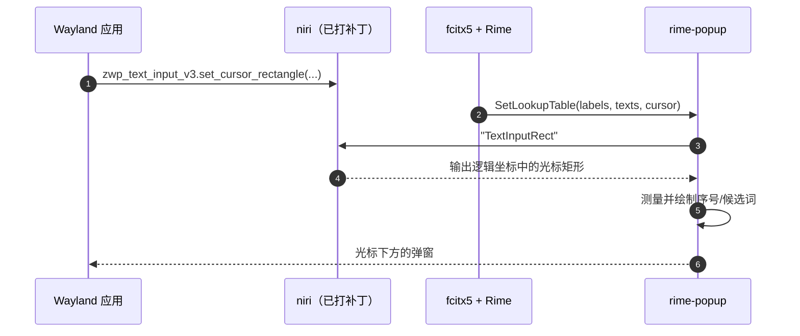

# rime-popup

[English](README.md) | **简体中文**

一个 Wayland 守护进程，在 [niri](https://github.com/yekeno/niri) 上把
**fcitx5 / Rime 候选窗绘制在光标下方**，并保留 fcitx5 的序号
（`1. 你  2. 泥  …`）。

它以普通用户进程运行：占用 fcitx5 的 kimpanel 总线名，向合成器询问当前文本
输入的光标矩形，然后用 `tiny-skia` + `wl_shm` 在该位置绘制一个
`zwlr_layer_shell_v1` 表面。不需要特权，也不需要修改 fcitx5。

- **配套合成器分支：** https://github.com/yekeno/niri
- **设计与数据流：** [docs/architecture.zh-CN.md](docs/architecture.zh-CN.md)
- **验证环境：** Ubuntu 22.04.5 LTS、Wayland、niri 26.04（含补丁）、fcitx5 5.0.14 + fcitx5-rime 5.0.11

## 特性

- 候选窗在 **Wayland 客户端**（`zwp_text_input_v3`）中跟随文本光标，而不只
  支持 X11/XIM 客户端。
- **保留序号。** fcitx5 提供的标签（`1.`、`2.`、`a.` …）会绘制在每个候选词
  前；缺失标签时自动编号。
- 支持 Rime / fcitx5 候选高亮、翻页指示、基于 swash 的 CJK 字形整形，以及
  可配置配色。
- 输入透明的覆盖层：键盘输入始终送到焦点应用，不会进入弹窗。
- 收到 `SIGHUP` 时重载配置；`SIGUSR1` 导出光标/焦点状态。
- 安全降级：合成器无法提供光标时，不抢占 fcitx5 自带候选窗，而是保持原状。

## 工作原理

```mermaid
flowchart LR
    A[Wayland 应用] -->|set_cursor_rectangle| N[niri + TextInputRect 补丁]
    F[fcitx5 + Rime] -->|kimpanel SetLookupTable| R[rime-popup]
    R -->|IPC "TextInputRect"| N
    N -->|光标 x/y/w/h| R
    R -->|wl_shm 缓冲区| L[layer-shell 覆盖层]
    L --> S[光标下方的带序号候选窗]
```



完整的模块划分与状态机见
[docs/architecture.zh-CN.md](docs/architecture.zh-CN.md)。

## 为什么需要 niri 补丁

Wayland 客户端把光标矩形发给**合成器**，而不是输入法。因此对 Wayland 客户端
来说，fcitx5 kimpanel 的 `SetSpotRect` 是空的，fcitx5 经典 UI 只能依赖合成器
自行摆放的 input-method 弹窗表面。

[yekeno/niri](https://github.com/yekeno/niri) 增加了一个 `TextInputRect` IPC
请求：

```text
→ "TextInputRect"
← {"Ok":{"TextInputRect":{"x":812,"y":244,"width":2,"height":18}}}
```

niri 会把焦点窗口的位置加到客户端的表面局部矩形上，以输出逻辑坐标回复；并在
键盘焦点变化时清除缓存矩形，避免旧光标泄漏到新窗口。

该请求依赖一个小的 [smithay
分支](https://github.com/yekeno/smithay/tree/niri-text-input-rect)，用于暴露
缓存的 `zwp_text_input_v3` 光标矩形。niri 分支的 `[patch]` 段已经自动指向它。

如果 niri 不响应，rime-popup 会刻意**不**占用 `org.kde.impanel`；fcitx5 继续
使用 `classicui` 和自己的候选窗。详见
[niri 补丁文档](https://github.com/yekeno/niri/blob/main/docs/text-input-rect.zh-CN.md)。

## 验证环境

以下是开发和验证该功能时使用的机器：

| 组件 | 版本 / 值 |
| --- | --- |
| OS | Ubuntu 22.04.5 LTS (jammy), x86_64 |
| 内核 | 6.8.0-138-generic |
| libc | glibc 2.35 |
| 会话 | Wayland（`XDG_SESSION_TYPE=wayland`，`XDG_CURRENT_DESKTOP=niri`） |
| 合成器 | niri 26.04（`v26.04-192-g4263c9a1` + TextInputRect 补丁） |
| smithay | 上游 `9786228` 的 0.7.0 + 光标矩形访问器 |
| 输入法 | fcitx5 5.0.14、fcitx5-rime 5.0.11、librime 1.7.3 |
| Rust | rustc / cargo 1.93.1（rustup） |
| libinput | 源码构建 1.25.0（Ubuntu 22.04 自带的 1.20 对 niri 太旧） |
| Wayland | 1.24.0（`savoury1/display` PPA） |
| libdisplay-info | 0.2.0（`savoury1/display` PPA） |
| CJK 字体 | `/usr/share/fonts/opentype/noto/NotoSansCJK-Regular.ttc` |

Ubuntu 22.04 在构建 niri 前需要两个非系统自带组件：`libdisplay-info` 和
libinput ≥ 1.21。验证机器把 libinput 1.25.0 安装到私有前缀
（`/srv/tools/wm/build/libinput-prefix`），并通过 pkg-config 与链接器
（`RUSTFLAGS` 中的 `-L native=…` 和 rpath）指向它。具体命令见
[niri 构建文档](https://github.com/yekeno/niri/blob/main/docs/text-input-rect.zh-CN.md#在-ubuntu-2204-上构建本分支)。

Ubuntu 22.04 的 `libwayland` 较旧且没有 `libdisplay-info-dev`；下面的 niri
构建步骤通过 `savoury1/display` PPA 安装这两个包。rime-popup 本身只需要
`libwayland-dev`。

## 安装

### 1. 安装已打补丁的 niri

按照
[niri 构建说明](https://github.com/yekeno/niri/blob/main/docs/text-input-rect.zh-CN.md)
操作。简化版：

```bash
sudo apt update
sudo apt install -y build-essential pkg-config clang \
    libudev-dev libgbm-dev libxkbcommon-dev libegl1-mesa-dev \
    libwayland-dev libinput-dev libsystemd-dev libdbus-1-dev \
    libseat-dev libpipewire-0.3-dev libpango1.0-dev

# Ubuntu 22.04：较新的 Wayland + libdisplay-info
sudo add-apt-repository ppa:savoury1/display
sudo apt update
sudo apt install -y libdisplay-info-dev libwayland-dev

# Ubuntu 22.04 自带 libinput 1.20，但 niri 需要 >= 1.21（dwtp 符号）。
# 先把 1.25.0 构建到私有前缀并在 cargo build 前导出；详见
# https://github.com/yekeno/niri/blob/main/docs/text-input-rect.zh-CN.md

git clone https://github.com/yekeno/niri.git
cd niri
cargo build --release
sudo install -m755 target/release/niri /usr/local/bin/niri
```

注销并重新登录，确保运行的是新编译的合成器。验证：

```bash
niri --version
printf '"TextInputRect"\n' | socat - "UNIX-CONNECT:$NIRI_SOCKET"
```

第二条命令必须输出 `Ok` 回复（矩形或 `null`）。

### 2. 安装 fcitx5 + Rime

```bash
sudo apt install -y fcitx5 fcitx5-rime fcitx5-modules fonts-noto-cjk
```

确保 fcitx5 随 Wayland 会话启动，并选择 Rime 作为输入法。kimpanel 支持
（`libkimpanel.so`）包含在 `fcitx5-modules` 中。

### 3. 构建 rime-popup

```bash
sudo apt install -y build-essential pkg-config libwayland-dev
curl --proto '=https' --tlsv1.2 -sSf https://sh.rustup.rs | sh
source "$HOME/.cargo/env"

git clone https://github.com/yekeno/rime-popup.git
cd rime-popup
cargo build --release
install -m755 target/release/rime-popup ~/.local/bin/rime-popup
```

### 4. 安装用户服务

```bash
mkdir -p ~/.config/systemd/user
cp packaging/systemd/rime-popup.service ~/.config/systemd/user/
systemctl --user daemon-reload
systemctl --user enable --now rime-popup.service
systemctl --user status rime-popup.service
```

你的会话必须 want `graphical-session.target`。该单元刻意使用**用户**服务：
系统服务会在图形会话之外启动，看不到 Wayland socket 和 fcitx5 的会话总线。

## 使用

打开任意 Wayland 文本框，切换到 Rime 并输入中文。带序号的候选窗会出现在
**光标正下方**。

常用检查：

```bash
# fcitx5 应使用我们的面板
busctl --user call org.fcitx.Fcitx5 /controller \
    org.fcitx.Fcitx.Controller1 CurrentUI
# → s "kimpanel"

# 导出 seat/globals/focus/caret
kill -USR1 $(pgrep -x rime-popup)
journalctl --user -u rime-popup.service -n 5 --no-pager
```

修改配置后重载：

```bash
systemctl --user reload rime-popup.service   # SIGHUP
```

如果守护进程异常退出而 fcitx5 没有察觉，把候选窗交还 fcitx5：

```bash
busctl --user call org.fcitx.Fcitx5 /controller \
    org.fcitx.Fcitx.Controller1 SetCurrentUI s classicui
```

### 配置

配置路径：`$XDG_CONFIG_HOME/rime-popup/config.toml`，回退到
`~/.config/rime-popup/config.toml`。可用 `--config PATH` 覆盖。所有字段都是
可选的；文件不存在时使用内置默认值。

```toml
[general]
log = "info"

[render]
font_size = 14
font_fallback_cjk = "/usr/share/fonts/opentype/noto/NotoSansCJK-Regular.ttc"
line_padding = 8
candidate_gap = 12
label_gap = 6
bg = "#1e1e1e"
highlight_bg = "#3a3a3a"
text = "#e6e6e6"
border = "#666666"
border_width = 1
vertical_offset = 4          # 光标底部与弹窗之间的间距

[wayland]
layer = "overlay"            # background | bottom | top | overlay
anchor = "top-left"
```

启动时 `RUST_LOG` 会覆盖 `[general].log`。`[filter]` 表
（`ignore_app_ids`、`show_preedit`、`show_aux_up`、`show_aux_down`）和
`output_name` 会被解析，但**尚未生效**；它们是为后续工作预留的。

## 故障排查

| 现象 | 检查 |
| --- | --- |
| 完全没有弹窗 | `fcitx5 CurrentUI` 必须是 `kimpanel`；否则 rime-popup 没有发布 |
| 日志出现 “niri does not report text input rectangles” | niri 未打补丁/版本错误，或 IPC 请求被拒绝 |
| `{"Err":"error parsing request"}` | 请求必须是裸 `"TextInputRect"` 行，而不是 `{"Request":…}` |
| 弹窗出现在屏幕左上角 | 光标矩形尺寸为 0；守护进程会隐藏 |
| 没有候选词但光标正常 | `SIGUSR1` 导出：`focused_ic` 为空 vs `caret_rect` 为 `None` |
| 崩溃后 fcitx5 没有窗口 | 执行 `SetCurrentUI … classicui`，然后重启 rime-popup |
| 构建 `libdisplay-info` 失败 | 从 `savoury1/display` PPA 安装（Ubuntu 22.04） |

`SIGUSR1` 可以区分三种外观相同的故障：没有输入上下文、上下文没有候选词、
没有光标。

## 开发

```bash
cargo test                    # 单元 + 封闭式集成测试
cargo clippy --all-targets
./tests/smoke.sh              # 端到端；无 WAYLAND_DISPLAY 时跳过
```

## 相关项目

- [yekeno/niri](https://github.com/yekeno/niri) — 带 `TextInputRect` 光标 IPC
  的 niri。
- [yekeno/smithay](https://github.com/yekeno/smithay/tree/niri-text-input-rect)
  — 暴露缓存文本输入光标矩形的 smithay 分支。
- 上游：[niri-wm/niri](https://github.com/niri-wm/niri)、
  [Smithay/smithay](https://github.com/Smithay/smithay)。

## 许可证

MIT
