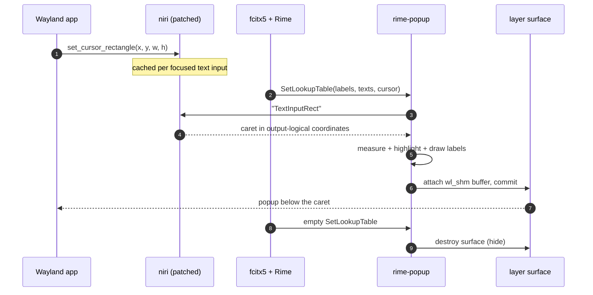

# Architecture and data flow

rime-popup is a user daemon with two event loops joined by one channel:

- a **calloop** loop that owns the Wayland connection and the candidate layer
  surface;
- a **tokio** thread that owns the D-Bus connection to fcitx5 and implements
  the kimpanel panel.

The only shared state between them is the `ipc::DaemonToWayland` channel. The
D-Bus thread never touches Wayland, and the Wayland loop never blocks on
D-Bus.

## Components

| Module | Responsibility |
| --- | --- |
| `src/main.rs` | load config, initialise tracing, boot the runtime |
| `src/runtime.rs` | calloop loop, Wayland globals, popup lifecycle, signals |
| `src/fcitx5/kimpanel.rs` | own `org.kde.impanel`, receive candidates and the fallback spot rect |
| `src/niri_ipc.rs` | ask niri for the focused text input's caret rectangle |
| `src/state.rs` | per-input-context focus and lookup-table state |
| `src/popup/mod.rs` | decide whether a frame is drawable and paint it |
| `src/render/` | layout metrics, swash text shaping, tiny-skia painting |
| `src/wayland/popup.rs` | one `zwlr_layer_surface_v1` surface plus `wl_shm` buffers |

## End-to-end data flow

```mermaid
flowchart LR
    A[Wayland app] -->|zwp_text_input_v3<br/>set_cursor_rectangle| N[niri + patched smithay]
    F[fcitx5 + Rime] -->|D-Bus<br/>SetLookupTable| K[kimpanel server<br/>tokio thread]
    K -->|DaemonToWayland::LookupTable| R[calloop runtime]
    R -->|IPC "TextInputRect"| N
    N -->|{"Ok":{"TextInputRect":…}}| R
    R --> P[decide_and_paint]
    P -->|tiny-skia ARGB8888| S[wl_shm buffer]
    S -->|attach + commit| L[layer-shell overlay]
    L --> V[screen: numbered candidates<br/>under the caret]
```

### Sequence



## Process design

### 1. Startup

1. Load `config.toml` (or built-in defaults when the file is absent).
2. Connect to the Wayland socket, enumerate globals, bind
   `wl_compositor`, `wl_shm`, `wl_seat`, `zwp_text_input_manager_v3` and
   `zwlr_layer_shell_v1`.
3. Create one `zwp_text_input_v3` per seat.
4. Install calloop signal handlers (SIGHUP/SIGUSR1/SIGINT/SIGTERM).
5. Start the fcitx5 D-Bus thread and insert the IPC channel into the loop.

### 2. Capability probe

Before owning `org.kde.impanel`, the daemon asks niri for `TextInputRect`:

- **niri answers `Ok`** → publish kimpanel. fcitx5 switches `CurrentUI` to
  `kimpanel` and stops drawing its own window.
- **niri rejects the request** → do **not** own the name. Owning it would
  disable fcitx5's UI while leaving rime-popup without a caret. fcitx5 stays
  on `classicui`, which is the safe degradation.

### 3. Candidate update

`SetLookupTable` arrives on D-Bus. The handler:

1. strips fcitx5's synthetic `auxDown` entry (it has an empty label and shifts
   `cursor` by one);
2. fills missing position labels with `1.`, `2.`, … while preserving labels
   fcitx5 supplied — this is why numbers stay on screen;
3. sends `FocusIn`, a freshly queried caret (windows can move without a new
   cursor rectangle), and `LookupTable` through the channel.

`SetSpotRect` is the fallback for X11/XIM clients: when niri has no
text-input rectangle, kimpanel's spot rect is used instead.

### 4. Frame decision and painting

`popup::decide_and_paint` returns a frame only when:

- a lookup table with candidates is focused, and
- a caret rectangle is known and non-zero.

Layout reserves a cell for every candidate, including its label, so the width
is stable when labels are present. Painting fills the background, draws the
highlighted cell, shapes each candidate with swash, and strokes the border.

### 5. Presentation

The first frame creates a `zwlr_layer_surface_v1` on the `overlay` layer,
anchored top-left, with:

```text
top margin  = caret.y + caret.height + render.vertical_offset
left margin = caret.x
size        = measured popup size
```

The surface is input-transparent (`keyboard_interactivity = none`) and not
part of any layout (`exclusive_zone = -1`). A `wl_shm` buffer is attached and
committed; it is freed only after the compositor sends `wl_buffer.release`.

### 6. Hide

An empty lookup table, a zero-sized caret, a focus-out, or a closed layer
surface destroys the surface. The cached frame is cleared so a later
configure cannot resurrect stale pixels.

### 7. Reload and diagnostics

| Signal | Action |
| --- | --- |
| `SIGHUP` | re-read config; invalid config is rejected and the running one stays |
| `SIGUSR1` | log seat, globals, focus id, caret rect, focused input context |
| `SIGINT` / `SIGTERM` | unwind the loop and exit 0 |

## Why the niri patch exists

Wayland clients report the caret to the compositor, not to the input method.
fcitx5's kimpanel API therefore carries an empty spot rectangle for Wayland
clients. The compositor is the only process that both sees
`set_cursor_rectangle` and knows where the focused window sits on its output.

The fork adds a `TextInputRect` IPC request plus the smithay accessor that
exposes the cached rectangle. See
[yekeno/niri → docs/text-input-rect.md](https://github.com/yekeno/niri/blob/main/docs/text-input-rect.md)
for the patch design and wire format.
