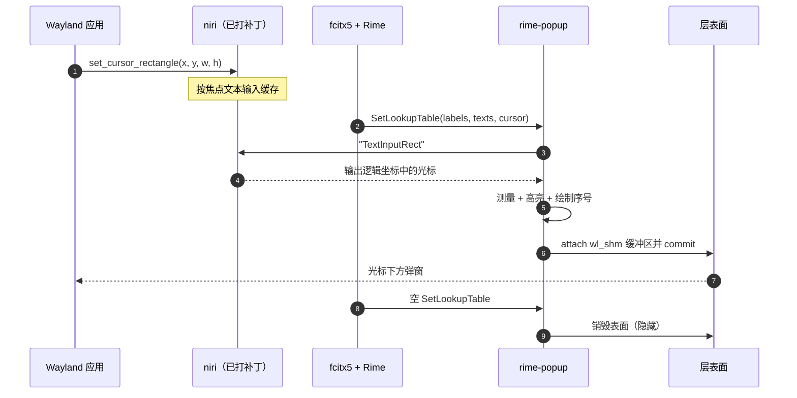

# 架构与数据流

[English](architecture.md) | **简体中文**

rime-popup 是一个用户态守护进程，内部有两个事件循环，通过一个通道连接：

- 一个 **calloop** 循环，负责 Wayland 连接和候选层表面；
- 一个 **tokio** 线程，负责与 fcitx5 的 D-Bus 连接，并实现 kimpanel 面板。

两者之间唯一的共享状态是 `ipc::DaemonToWayland` 通道。D-Bus 线程从不直接
操作 Wayland，Wayland 循环也不会阻塞在 D-Bus 上。

## 组件

| 模块 | 职责 |
| --- | --- |
| `src/main.rs` | 加载配置、初始化 tracing、启动运行时 |
| `src/runtime.rs` | calloop 循环、Wayland globals、弹窗生命周期、信号 |
| `src/fcitx5/kimpanel.rs` | 占用 `org.kde.impanel`，接收候选词和回退光标矩形 |
| `src/niri_ipc.rs` | 向 niri 询问焦点文本输入的光标矩形 |
| `src/state.rs` | 每个输入上下文的焦点和候选表状态 |
| `src/popup/mod.rs` | 判断当前帧是否可绘制并完成绘制 |
| `src/render/` | 布局度量、swash 字形整形、tiny-skia 绘制 |
| `src/wayland/popup.rs` | 一个 `zwlr_layer_surface_v1` 表面及 `wl_shm` 缓冲区 |

## 端到端数据流

```mermaid
flowchart LR
    A[Wayland 应用] -->|zwp_text_input_v3<br/>set_cursor_rectangle| N[niri + 已打补丁的 smithay]
    F[fcitx5 + Rime] -->|D-Bus<br/>SetLookupTable| K[kimpanel 服务端<br/>tokio 线程]
    K -->|DaemonToWayland::LookupTable| R[calloop 运行时]
    R -->|IPC "TextInputRect"| N
    N -->|{"Ok":{"TextInputRect":…}}| R
    R --> P[decide_and_paint]
    P -->|tiny-skia ARGB8888| S[wl_shm 缓冲区]
    S -->|attach + commit| L[layer-shell 覆盖层]
    L --> V[屏幕：光标下方的<br/>带序号候选窗]
```

### 时序



## 进程设计

### 1. 启动

1. 加载 `config.toml`（文件不存在时使用内置默认值）。
2. 连接 Wayland socket，枚举 globals，绑定
   `wl_compositor`、`wl_shm`、`wl_seat`、`zwp_text_input_manager_v3` 和
   `zwlr_layer_shell_v1`。
3. 为每个 seat 创建一个 `zwp_text_input_v3`。
4. 安装 calloop 信号处理器（SIGHUP/SIGUSR1/SIGINT/SIGTERM）。
5. 启动 fcitx5 D-Bus 线程，并把 IPC 通道插入循环。

### 2. 能力探测

在占用 `org.kde.impanel` 之前，守护进程先向 niri 请求 `TextInputRect`：

- **niri 返回 `Ok`** → 发布 kimpanel。fcitx5 把 `CurrentUI` 切换到
  `kimpanel`，并停止绘制自己的候选窗。
- **niri 拒绝请求** → **不**占用该总线名。否则会禁用 fcitx5 的 UI，而
  rime-popup 又没有光标。fcitx5 保持 `classicui`，这是安全的降级方式。

### 3. 候选词更新

`SetLookupTable` 通过 D-Bus 到达。处理逻辑：

1. 去掉 fcitx5 合成的 `auxDown` 项（它的标签为空，并且会把 `cursor` 偏移
   一位）；
2. 为缺失的位置标签填入 `1.`、`2.` …，同时保留 fcitx5 提供的标签——这就是
   序号始终显示的原因；
3. 通过通道发送 `FocusIn`、重新查询的光标（窗口可能移动但没有新的光标矩形）
   和 `LookupTable`。

`SetSpotRect` 是 X11/XIM 客户端的回退：当 niri 没有文本输入矩形时，使用
kimpanel 的 spot rect。

### 4. 帧决策与绘制

`popup::decide_and_paint` 仅在以下条件同时满足时返回一帧：

- 有带候选词的候选表处于焦点状态；
- 已知的光标矩形非零。

布局会为每个候选词（包括其标签）预留单元格，因此有标签时宽度仍然稳定。绘制
过程填充背景、绘制高亮单元格、用 swash 整形每个候选词，并描边。

### 5. 呈现

第一帧会在 `overlay` 层创建 `zwlr_layer_surface_v1`，锚定左上角，参数为：

```text
top margin  = caret.y + caret.height + render.vertical_offset
left margin = caret.x
size        = 测量得到的弹窗尺寸
```

该表面输入透明（`keyboard_interactivity = none`），也不参与布局
（`exclusive_zone = -1`）。随后 attach 并 commit 一个 `wl_shm` 缓冲区；
只有合成器发送 `wl_buffer.release` 后才释放它。

### 6. 隐藏

空候选表、零尺寸光标、焦点移出或层表面关闭都会销毁表面。缓存帧同时清空，
防止后续 configure 重新显示过期像素。

### 7. 重载与诊断

| 信号 | 动作 |
| --- | --- |
| `SIGHUP` | 重新读取配置；无效配置会被拒绝，继续使用旧配置 |
| `SIGUSR1` | 记录 seat、globals、焦点 id、光标矩形、焦点输入上下文 |
| `SIGINT` / `SIGTERM` | 退出循环并以 0 结束 |

## 为什么需要 niri 补丁

Wayland 客户端把光标报告给合成器，而不是输入法。因此 fcitx5 kimpanel API 对
Wayland 客户端携带的 spot 矩形是空的。只有合成器既能收到
`set_cursor_rectangle`，又知道焦点窗口在其输出上的位置。

该分支增加了 `TextInputRect` IPC 请求，以及 smithay 中暴露缓存矩形的访问器。
补丁设计和线格式见
[yekeno/niri → docs/text-input-rect.zh-CN.md](https://github.com/yekeno/niri/blob/main/docs/text-input-rect.zh-CN.md)。
